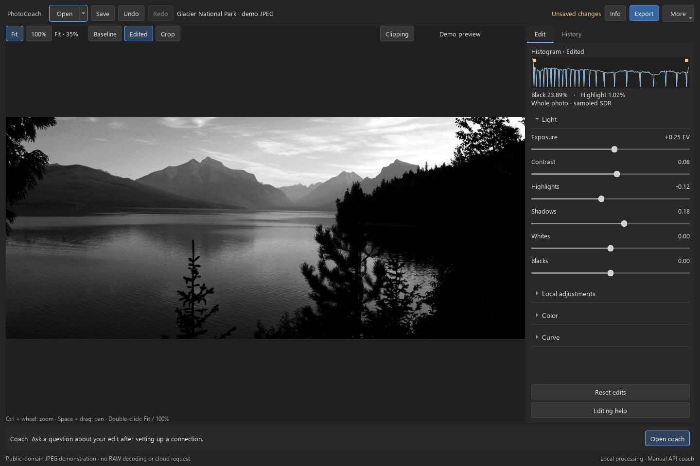

# PhotoCoach

A Windows RAW photo editor with non-destructive adjustments and an optional AI coach that can see the current edit, its parameters, and the changes that led to it.

PhotoCoach keeps the original file untouched. Editing, project recovery, and export run locally. Cloud coaching starts only when you ask for it.



*Workspace demonstration using a public-domain JPEG. This screenshot shows the editor and its controls; it does not demonstrate RAW decoding. [Image credit](THIRD_PARTY_NOTICES.md#demonstration-photograph).*

## Features

- Exposure, highlights, shadows, whites, blacks, contrast, saturation, vibrance, and sensor white balance.
- A shared RGB tone curve and an eight-color HSL mixer.
- Crop, straighten, and up to four linear or radial adjustment masks.
- Progressive previews, zoom and pan, a histogram, clipping overlays, and a neutral white balance picker.
- Grouped undo/redo and local project files that preserve editing history.
- Full-resolution JPEG and 16-bit TIFF export with an embedded sRGB profile.
- Optional manual coaching through OpenAI Responses, Chat Completions compatible services, or the native Gemini API.
- Saved connections, model selection, request review, session attempt limits, and Windows Credential Manager integration.

## Run on Windows

Use 64-bit Python 3.12. Sony Bayer `.ARW` files are the tested input format; other camera formats are not advertised as supported.

```powershell
git clone https://github.com/Xin-Chen-Max/photocoach-desktop.git
cd photocoach-desktop
py -3.12 -m venv .venv
& .\.venv\Scripts\python.exe -m pip install -r requirements-lock.txt
& .\.venv\Scripts\python.exe -m pip install --no-deps --no-build-isolation -e .
& .\.venv\Scripts\python.exe -m photocoach
```

After setup, you can also use **Start PhotoCoach.cmd**. The launcher uses the virtual environment in this directory.

Open a RAW file, make an adjustment, and compare it with the baseline. Save a `.photocoach` project to resume editing later, or export a JPEG/TIFF. Project files reference the original RAW; keep that file available.

An API key is optional. For cloud coaching, select **Set up AI coach**, choose a connection and model, and review the request before sending. API usage is billed by the selected provider. See the [usage guide](docs/usage.md).

## Engineering

The desktop interface uses PySide6. rawpy/LibRaw decodes RAW data into linear sRGB, NumPy applies edits, and Pillow/tifffile write exports.

Immutable editing snapshots separate user actions from background work. Preview results carry source, state, viewport, and quality identifiers so an older job cannot overwrite a newer view. Dragging uses a bounded temporary preview; settling and export use the formal processing path.

Rendering and cloud requests have separate lifecycles. A photo change, new edit, or connection change invalidates outdated feedback. Requests are never retried automatically.

Read the [architecture](docs/architecture.md) for module responsibilities, processing order, and design trade-offs.

## Tests

```powershell
& .\.venv\Scripts\python.exe -m pytest -q
```

The default suite uses synthetic images, temporary settings, and fake provider transports. It covers image processing, state/history, migration, file protection, request handling, and headless Qt interactions. It does not require a camera file or a paid API call. [Testing and verification](docs/testing.md) explains the separate real-RAW checks.

## Current limits

- Windows is the supported desktop target. This repository does not include an installer or a bundled executable.
- The rendering pipeline is SDR. LibRaw output can clip highlights before subsequent edits; exposure reduction cannot recover data already lost during decoding.
- Output is tagged sRGB. Monitor-profile conversion and HDR display are not implemented.
- Temporary adjustment previews are approximate. Inspect detail after **Full detail** appears.
- Lens correction, sharpening, denoising, brush masks, healing, and a photo library are not included.
- AI advice is advisory and is never applied automatically. A model listing does not prove image-analysis support, account access, or available quota.

## Documentation

- [Usage and privacy](docs/usage.md)
- [Architecture and processing](docs/architecture.md)
- [Testing and verification](docs/testing.md)
- [Contributing](CONTRIBUTING.md)
- [Release notes](CHANGELOG.md)

PhotoCoach source is available under the [MIT license](LICENSE). Dependencies and the demonstration photograph have their own [licenses and credits](THIRD_PARTY_NOTICES.md).
