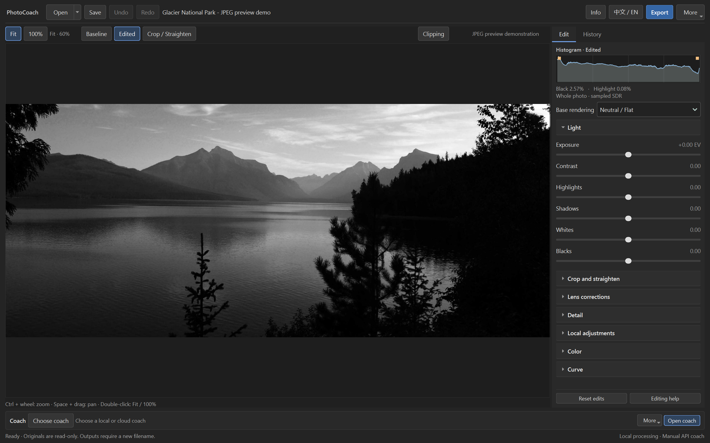
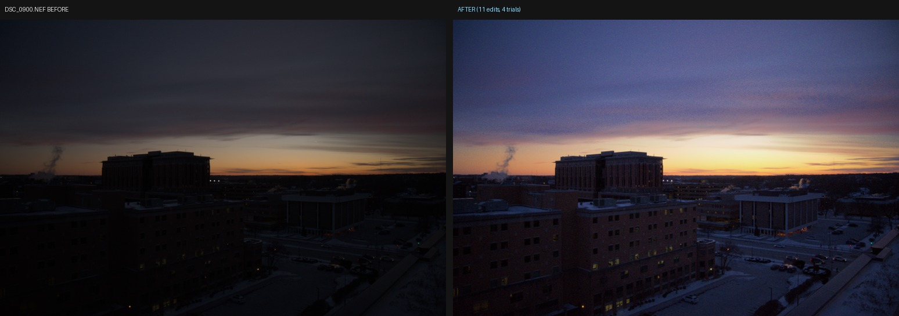
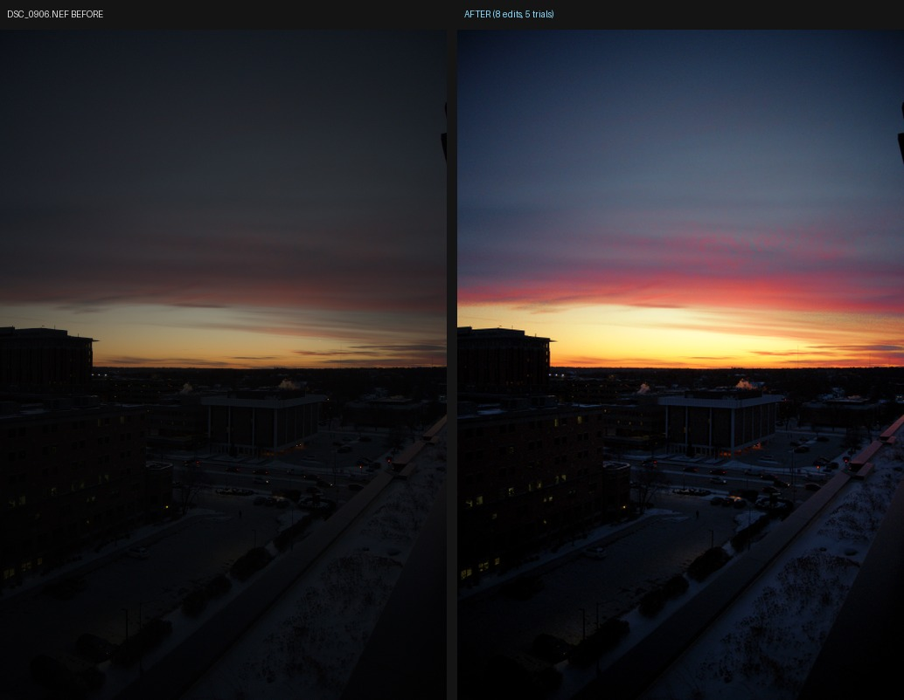
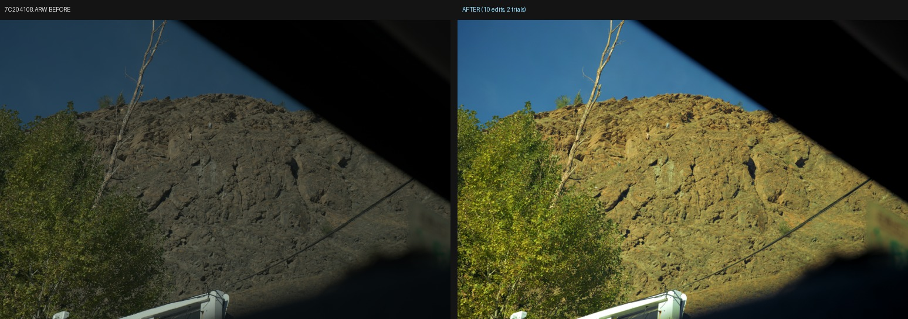
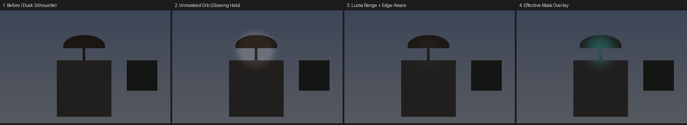

# PhotoCoach

A Windows RAW photo editor and bounded multimodal AI agent (`observe -> reason -> tool_call -> trial_render -> reflect -> finalize`) with non-destructive linear processing, active 1:1 demosaiced crop and Bayer CFA sensor inspection, visual reflexion trial self-repair, and a read-only Model Context Protocol (MCP) server.

The original photograph stays untouched. Editing, project recovery, and export run locally. Multimodal coaching starts only when you ask for it, and suggested edits apply only on explicit confirmation.



*Workspace demonstration using a public-domain JPEG. It shows the interface and controls, not RAW decoding. [Image credit](THIRD_PARTY_NOTICES.md#demonstration-photograph).*

## Before & After Showcase

All edits below run through PhotoCoach's non-destructive 16-bit linear/sRGB RAW pipeline (**Schema 14 / `phase1-sdr-srgb-v14`**) with read-only `.ARW`/`.NEF` originals and single-step Undo.

**Twilight Cityscape (`DSC_0900.NEF` · Local `qwen3.6:27b` Full Retouch · 11 edits / 4 trials)** — `Exposure +1.8 EV`, `Shadows +0.7`, `Highlights -0.4`, `Contrast +0.1`, S-curve, warm sunset & blue sky HSL, Teal/Orange 3-way Color Grading, `Vignetting -0.4 EV`:



**Dusk Skyline Sunset (`DSC_0906.NEF` · Local `qwen3.6:27b` Full Retouch · 8 edits / 5 trials)** — `Exposure +1.8 EV`, `Highlights -0.7`, `Shadows +0.7`, `Contrast +0.25`, S-curve, sunset red/orange/yellow HSL + cool shadow / warm highlight Color Grading, `Vignetting -0.6 EV`:



**Sunlit Rocky Hillside (`7C204108.ARW` · Local `qwen3.6:27b` Full Retouch · 10 edits / 2 trials)** — `Exposure +1.5 EV`, `Shadows +0.6`, `Highlights -0.2`, `Contrast +0.2`, S-curve, warm midtone / cool shadow Color Grading, earthy HSL boost, `Vignetting -0.5 EV`:



**Edge-Aware Luminance-Range Local Masking (Schema 14 Anti-Halo)** — 4-panel comparison of dusk silhouette lighting (`Before` vs. `Unmasked Orb Halo` vs. `Luma Range + Edge-Aware Guided Filter` vs. `Effective Mask Overlay`):



## Download for Windows

[Download PhotoCoach 0.12.1 for Windows 64-bit](https://github.com/Xin-Chen-Max/photocoach-desktop/releases/tag/v0.12.1) ([0.12.0 archive](https://github.com/Xin-Chen-Max/photocoach-desktop/releases/tag/v0.12.0)).

Extract the whole ZIP and run **PhotoCoach/PhotoCoach.exe**. Keep `_internal` beside it. Python is included. The executable is unsigned and targets Windows AMD64. Ollama and model weights are separate downloads. Verify the ZIP with the release's `SHA256SUMS.txt` if needed.

## Features

- Exposure, highlights, shadows, whites, blacks, contrast, saturation, vibrance, and sensor white balance.
- Natural / As Shot and Neutral base rendering, a shared RGB curve, 3-way Color Grading (Shadows / Midtones / Highlights wheels with blend & balance), and an eight-color HSL mixer.
- Crop, straighten, manual lens distortion/vignetting, non-destructive spot removal / healing (`Heal` / `Clone`), and up to four linear, radial, or brush masks with perceptual luminance-range (`Luma min` / `Luma max` / `Range feather`) and edge-aware guided filtering (anti-halo).
- Calibrated detail engine: sharpening, edge masking, luminance noise reduction, and color noise reduction running before display reduction.
- Progressive previews, 100% detail inspection, seamless zoom pyramid, histogram, clipping overlays, and a neutral white balance picker.
- Named snapshots with zoom/pan-preserving A/B comparison, grouped undo/redo, and local Schema 14 projects that preserve full edit history.
- Full-resolution JPEG and 16-bit TIFF export with an embedded sRGB profile.
- Autonomous multimodal coaching agent (Agent v2) with a bounded ReAct state-graph runtime (`observe -> reason -> tool_call -> trial_render -> reflect -> finalize`), default multi-pass **Full Retouch** & **Coach** modes, visual reflexion trial self-repair (including `halo_bleed` anti-halo checks & silhouette isolation), manual **Did it help?** follow-up review, and strict turn/budget limits.
- Built-in **Local LLM Multi-Model Manager** (`Manage local AI`: curated catalog, VRAM fit detection, Managed/Existing Ollama modes, live download/verification, and darkroom `TrialCompareWidget` split/side-by-side viewer) alongside Cloud Gemini / OpenAI connections.
- Active Vision toolset: 1:1 demosaiced crop inspection (`inspect_region_100pct`), normalized Bayer CFA sensor headroom probing (`probe_sensor_headroom`), and 8-band HSL/CIELAB zoning (`analyze_hsl_zones`).
- Unified multi-protocol tool calling across Gemini (`thoughtSignature` + `$ref` multimodal `FunctionResponse.parts`), OpenAI Responses, Chat Completions, and local Ollama (`qwen3.6:27b`).
- Read-only Model Context Protocol (MCP `2025-06-18`) stdio server (`photocoach-mcp`) sharing editing and sensor diagnostic tools with external agents.
- Zero-dependency bilingual BM25 Playbook RAG (24 pipeline-calibrated recipe cards) and privacy-preserving style memory.
- 25-scenario evaluation and benchmark harness (`photocoach-eval`) measuring reasoning, reflexion recovery, prompt-injection defense, and tool robustness.
- Reviewed suggestions with visible target values, explicit application, cancellation and stale-response protection.
- English and Chinese interface controls; documentation is in English.

## Use the editor

Open a Sony `.ARW` or Nikon `.NEF`, make an adjustment, and compare it with the baseline. Save a `.photocoach` project to resume editing later, or export a JPEG/TIFF. Projects reference the original RAW, so keep that file available. Sony ARW is the primary real-image validation set; camera coverage is limited.

Inspect sharpening and noise reduction at **100%** after **Full detail** appears. Spatial filters now run at native pixel scale before display reduction. Fit hides fine changes and takes more processing time with active detail filters. Ordinary tonal gestures retain a faster approximation.

Open the bottom **Coach** panel and choose a saved connection, configure a cloud provider, or prepare a local model through **Choose coach**. Type a question and click **Analyze photo**; Ctrl+Enter submits and Enter adds a line. Review cloud requests and per-run budgets before sending. During analysis, the Agent v2 runtime can inspect 1:1 demosaiced crops, probe Bayer CFA headroom, query the bilingual editing playbook, and preview candidate adjustments in a sandboxed trial loop. Suggestions only change the photograph after an explicit **Apply suggestion** click. API usage is billed by the provider. See [usage and privacy](docs/usage.md).

## Run from source

Use 64-bit Python 3.12:

```powershell
git clone https://github.com/Xin-Chen-Max/photocoach-desktop.git
cd photocoach-desktop
py -3.12 -m venv .venv
& .\.venv\Scripts\python.exe -m pip install -r requirements-lock.txt
& .\.venv\Scripts\python.exe -m pip install --no-deps --no-build-isolation -e .
& .\.venv\Scripts\python.exe -m photocoach
```

**Start PhotoCoach.cmd** uses the virtual environment in this directory.

## Engineering

PySide6 provides the darkroom desktop interface. rawpy/LibRaw decodes RAW data into linear sRGB, NumPy applies edits, and Pillow/tifffile write exports.

Immutable editing snapshots separate user actions from background work. Results carry source, revision, viewport and quality identifiers so an older job cannot overwrite a newer view. Rendering uses bounded strips, reusable decoded data, a seamless zoom pyramid, and coalesced preview requests. Spatial detail filters run at native pixel scale with halo padding so settled 100% regions match exports.

The multimodal coaching engine runs on a bounded state-graph ReAct runtime (`AgentRuntime`) with explicit turn, tool, trial, and dollar-budget reservations (`RunBudget` / `SessionBudget`). Instead of relying on downscaled thumbnails alone, the agent actively invokes read-only diagnostic tools—1:1 demosaiced native crops (`inspect_region_100pct`), normalized Bayer CFA headroom probes (`probe_sensor_headroom`), 8-band HSL/CIELAB zoning (`analyze_hsl_zones`), and a bilingual BM25 Playbook RAG—then validates candidate edits through a sandboxed `propose_and_preview_trial` visual reflexion loop before presenting suggestions. The same schema-validated tool registry is exposed over a zero-bloat JSON-RPC `stdio` MCP server (`photocoach-mcp`).

Read the [architecture](docs/architecture.md) for processing order, module boundaries and trade-offs.

## Tests and builds

```powershell
& .\.venv\Scripts\python.exe -m pytest -q
& .\.venv\Scripts\python.exe scripts\verify_wheel.py --output verification-runs\wheel-check
& .\.venv\Scripts\python.exe scripts\run_agent_eval.py
```

The default suite uses synthetic images, temporary settings and fake provider transports. Real-RAW checks and native UI captures are separate. [Testing and verification](docs/testing.md) records their coverage and limits.

To start the stdio Model Context Protocol (MCP) server for external agent integration:

```powershell
& .\.venv\Scripts\python.exe -m photocoach.mcp_server
```

To build a portable executable on Windows:

```powershell
& .\.venv\Scripts\python.exe -m pip install -r requirements-build.txt
& .\.venv\Scripts\python.exe scripts\build_windows.py --output dist\win64
& .\.venv\Scripts\python.exe scripts\verify_windows_bundle.py dist\win64\PhotoCoach-0.12.1-win64.zip verification-runs\bundle-check
```

## Current limits

- The pipeline is SDR. LibRaw's integer output can clip highlights or out-of-gamut colors before later edits; negative exposure cannot recover those values.
- Natural is an independent baseline look. It does not reproduce a camera JPEG or a commercial RAW processor. Camera profiles, monitor-profile conversion and HDR display are not implemented.
- Native detail processing makes large Fit updates slower. Retained-cache limits do not bound total process peak memory.
- A photo library, automatic saving, automatic lens profiles, and AI denoise are not included.
- Model capability checks do not establish aesthetic judgment, account quota or repeated coaching quality. A local model and Ollama require separate installation/preparation.
- The executable is unsigned. Another physical Windows machine and ARM64 have not been validated.

## Documentation

- [Usage and privacy](docs/usage.md)
- [Architecture and processing](docs/architecture.md)
- [Testing and verification](docs/testing.md)
- [Contributing](CONTRIBUTING.md)
- [Release notes](CHANGELOG.md)

PhotoCoach source is available under the [MIT license](LICENSE). Dependencies and the demonstration photograph have their own [licenses and credits](THIRD_PARTY_NOTICES.md).
