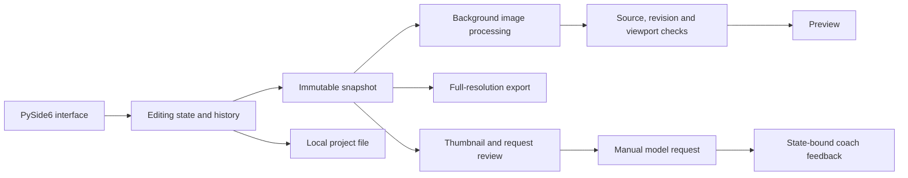

# Architecture

PhotoCoach is a single-process desktop application. It has no web server, database, or hosted photo storage.

## Module boundaries

| Area | Modules | Responsibility |
| --- | --- | --- |
| Desktop coordination | `app.py`, `workspace_ui.py`, `workspace_widgets.py` | Window layout, event wiring, worker scheduling, and workflow coordination |
| Editing state | `state.py`, `composition.py`, `color_mixer.py`, `gradients.py` | Validated values, snapshots, grouped transactions, undo, and redo |
| Image processing | `imaging.py`, `adjustments.py`, `preview.py`, `detail_cache.py`, `scratch.py` | RAW decoding, shared processing, visible-region rendering, and bounded retained buffers |
| Editing controls | `curve.py`, `composition_ui.py`, `color_mixer_ui.py`, `gradient_ui.py`, `gradient_view.py`, `white_balance.py` | Curve, crop, color, masks, and white balance interaction |
| Persistence | `project.py`, `safe_io.py` | Project validation and migration, source verification, and atomic writes |
| Coaching | `coach.py`, `api_coach.py`, `auto_coach.py`, `coach_view.py`, `coach_ui.py` | Context construction, provider adapters, feedback display, and developer mock mode |
| Connections | `connections.py`, `settings.py`, `credentials.py`, `model_catalog.py`, `budget.py` | Saved nonsecret configuration, credential references, model metadata, and session limits |

## Processing order

RAW files are opened read-only. rawpy/LibRaw applies the selected sensor white balance and produces uint16 linear sRGB. Subsequent processing uses float32 arrays:

1. Crop and straighten in linear light.
2. Global exposure and luminance-weighted highlights/shadows, including enabled local masks.
3. SDR clipping and sRGB encoding.
4. Whites/blacks, contrast, saturation, and vibrance.
5. HSL color mixing and the shared RGB curve.
6. One quantization step at the preview or export boundary.

The same formal editing functions serve settled previews and full-resolution exports. During a gesture, a separate reduced visible-region preview favors interaction speed. It is labeled **Adjusting**, retained during **Refining**, and replaced by **Full detail** when formal rendering finishes.

At 100% zoom, one source pixel maps to one physical display pixel. Retained linear buffers have a combined 512 MiB budget; display buffers have a separate budget. These budgets do not cap total process peak memory.

## State and background work

The UI changes validated state through `StateStore`. A drag groups intermediate values into one undo step while preserving the operation audit. Workers receive snapshots instead of reading mutable controls.

Image results are checked against the source, revision, viewport generation, and quality. Rendering keeps a latest pending intent rather than an unlimited queue. Cancelling a stale job prevents it from publishing pixels or feedback into a newer session.

Project schema 7 stores the source path and hash, parameters, undo/redo history, and dependency provenance. Known older schemas migrate in memory and are validated by replaying their histories. Opening a project does not rewrite the original file.

## External requests

`build_request` constructs state-matched reduced images and editing context. `api_coach.py` adapts this request to each provider protocol and validates structured feedback. The review dialog exposes the destination, model, images, context, and budget before dispatch.

Keys are resolved from the selected source only: a session value, a Windows credential, or a named environment variable. Connection JSON and project files do not store key values. HTTPS requests have bounded deadlines and response sizes, with no automatic retries.

An edit or cancellation cannot retract a request already received by a provider. The application discards stale results locally, while any provider charge remains outside its control.

## Trade-offs

Qt Widgets provides a native desktop workflow without a separate frontend service. NumPy keeps the processing path inspectable and testable, but large final previews can take noticeable time. The cache limits retained data rather than making a promise about all transient allocations.

The pipeline is deliberately limited to SDR sRGB output. It does not implement camera profiles, scene-linear highlight recovery, monitor ICC conversion, or parity with commercial RAW processors.
