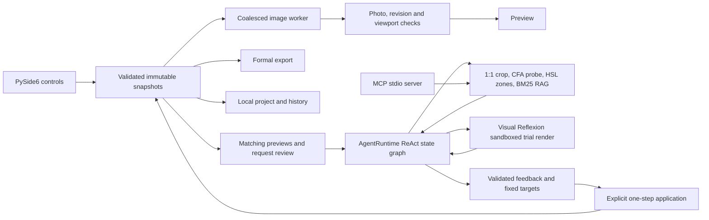

# Architecture

PhotoCoach is a single-process Windows desktop application. It has no hosted photo storage or database. Optional cloud requests and the separately managed local Ollama process sit outside the image-rendering worker.

## Module boundaries

| Area | Modules | Responsibility |
| --- | --- | --- |
| Desktop | `app.py`, `cli.py`, `workspace_ui.py`, `workspace_widgets.py`, `preview_view.py`, `histogram.py`, `theme.py`, `i18n.py` | Layout, bilingual controls, scheduling and result presentation |
| State | `state.py`, `composition.py`, `lens.py`, `detail.py`, `color_mixer.py`, `color_grading.py`, `gradients.py`, `snapshots.py`, `spots.py` | Validated parameters, geometry, named snapshots, spot healing and grouped undo/redo |
| Rendering | `imaging.py`, `adjustments.py`, `preview.py`, `detail_cache.py`, `scratch.py`, `render_timing.py` | RAW decoding, tone/spot/spatial processing, strips, cache reuse and timings |
| Controls | `curve.py`, `composition_ui.py`, `lens_ui.py`, `detail_ui.py`, `color_mixer_ui.py`, `color_grading_ui.py`, `gradient_ui.py`, `gradient_view.py`, `snapshots_ui.py`, `spots_ui.py`, `white_balance.py`, `edit_controls.py` | Parameter interaction and source-coordinate handles/picking/overlay |
| Persistence | `project.py`, `safe_io.py` | Versioned projects, migration/replay, hashing and atomic protected writes |
| Coach | `coach.py`, `api_coach.py`, `coach_actions.py`, `coach_view.py`, `coach_ui.py`, `auto_coach.py`, `devmode.py` | Context, provider protocols, action validation, display and developer mock |
| Agent Kernel | `agent_runtime.py`, `coach_agent.py`, `agent_tools.py`, `agent_memory.py`, `agent_eval.py` | Bounded ReAct loop (`observe -> reason -> tool_call -> trial_render -> reflect -> finalize`), visual reflexion criticism, active 1:1 and CFA tools, BM25 Playbook RAG, and eval benchmark |
| MCP & Telemetry | `mcp_server.py`, `telemetry.py` | Model Context Protocol stdio server (`2025-06-18`), structured audit logs, and OpenTelemetry spans |
| Connections | `connections.py`, `settings.py`, `credentials.py`, `model_catalog.py`, `budget.py`, `text_probe.py`, `models.py` | Nonsecret settings, explicit credential sources, catalogs, budgets and compatibility names |
| Local AI | `ollama_client.py`, `local_runtime.py`, `local_models_ui.py` | Fixed loopback protocol, owned process, model preparation and cancellation |

## Rendering order

RAW is opened read-only. LibRaw handles sensor black/white levels, camera/custom sensor white balance, demosaicing and camera-to-linear-sRGB conversion. Its uint16 output becomes float32. Gamma is linear at decode and sRGB encoding occurs once downstream.

1. Crop, straighten and manual distortion sampling in linear light.
2. Linear vignetting, linear spot removal/healing (`spots.py`), continuous highlight-guarded exposure and luminance-weighted global/local highlights, shadows, and local warmth gated by perceptual luminance-range and edge-aware guided masks (`gradients.py`, `16`-pixel halo overlap).
3. Versioned base rendering, SDR clipping and sRGB encoding.
4. Whites/blacks, contrast, saturation and vibrance.
5. 3-way Color Grading (`color_grading.py`), HSL mixing (`color_mixer.py`), and shared RGB curve.
6. Encoded luminance/chroma detail filters.
7. Display reduction where needed and one output quantization.

Natural is a fixed, monotonic luminance shoulder with gamut handling. Neutral and Legacy preserve the compatible flatter base. Creative slider values remain independent. No per-photo automatic exposure or black-point fitting is added.

Formal 100% regions and full exports share operators. Spatial detail filters use six-pixel halo padding (upgraded to `16`-pixel overlap via `required_halo` when edge-aware local masks are active) around 128-row strips. Applying sharpening after a reduced preview would enlarge its source-pixel radius, so active detail gestures filter natively first. A display-only request flag keeps the same path through zero. Plain tone gestures retain pre-tone reduction as a speed approximation.

Retained linear buffers share a 512 MiB limit and display buffers a 64 MiB limit. Large views use at most four strip workers inside the single active image job. These limits do not bound peak process memory.

## State and concurrency

`StateStore` is the mutation boundary. A gesture keeps intermediate audit events and creates at most one history item. Workers receive snapshots. Rendering coalesces pending intents and checks photo/session/revision, viewport generation and quality before accepting results. Cancellation is checked between bounded work units.

Schema 14 stores source identity, base rendering, parameters (including color grading, brush/luma-range/edge-aware masks, and spot removal), named snapshots, dependency provenance and complete undo/redo history. Older Schema 1–13 projects migrate strictly read-only in memory and replay their histories. Schema 1-8 base modes become Legacy so opening does not change their appearance. Opening never writes over an old project.

Coaching runs on a bounded state-graph runtime (`AgentRuntime`: `observe -> reason -> tool_call -> trial_render -> reflect -> finalize`) with separate request ownership, generation checks, `RunBudget` turn/tool/trial ceilings, and per-turn `SessionBudget` dollar reservations. When the network worker invokes image-inspection tools (`inspect_region_100pct`, `probe_sensor_headroom`, `propose_and_preview_trial`), execution marshals safely onto the serial single-owner image engine pool via queued Qt signals and event synchronization. Provider prose and trace timelines are HTML-escaped. Supported actions are validated against explicit target types/ranges and converted to immutable fixed targets from the analyzed revision. Text alone does not enable application. Applying verifies the whole result and uses one undo step. Photo, question, edit, connection or model changes make earlier replies reference-only.

## Network and local runtime

Cloud requests use HTTPS, bounded size/deadlines and no automatic retry or redirect. Review precedes sending unless the user explicitly enables session-only direct sending. Key values are resolved only from the chosen source and never serialized to projects/settings. Local cancellation cannot undo an external charge.

The Ollama client is separate: plain HTTP only to PhotoCoach's fixed `127.0.0.1:11435`, with no proxy, redirect or cloud credential access. The managed process has an independent model directory and cloud disabled; only its own process tree is stopped. Downloads use streaming progress and explicit success/install checks. Vision-probe validity is bound to directory, model digest and engine version.

## Distribution and trade-offs

PyInstaller builds an unsigned AMD64 folder ZIP from explicit application assets. It includes runtime licenses, dependency versions and LF-normalized source hashes. Build PATH isolation prevents unrelated tools from supplying same-named native libraries. The extracted bundle is tested with the checkout and Python removed from PATH.

NumPy keeps operators inspectable and deterministic, while large native Fit previews remain expensive. SDR clipping, camera-profile coverage and monitor color management remain limits. The application does not claim Lightroom/camera-JPEG equivalence or aesthetic validation of a model.
